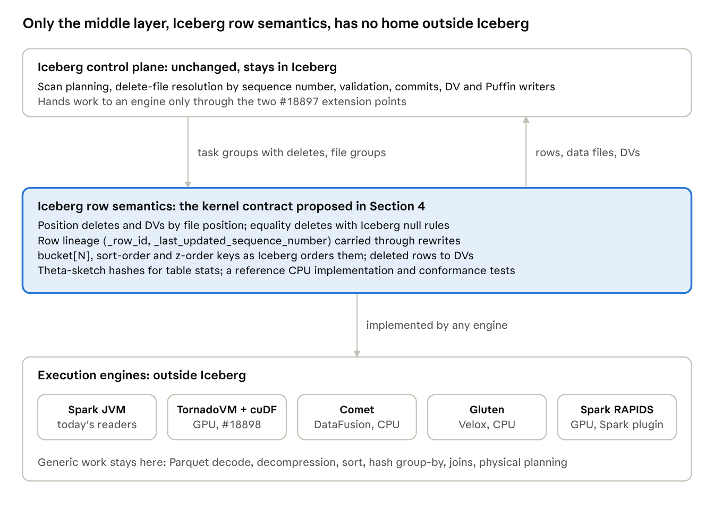

# Iceberg GPU acceleration: layering and kernel contracts

*Design proposal for discussion, 2026-11-19. Related PRs: [apache/iceberg#18897](https://github.com/apache/iceberg/pull/18897) (extension points) and [apache/iceberg#18898](https://github.com/apache/iceberg/pull/18898) (GPU module). Benchmark data and scripts: [`results/comet-gluten`](results/comet-gluten).*

## 1. Summary

Iceberg should own two thin Spark extension points and an engine-neutral statement of its per-row delete and maintenance semantics. Execution on a GPU, or in any native engine, stays outside Iceberg.

This document answers three questions raised in community feedback on #18897 and #18898:

1. **Which parts are Iceberg-specific, and which belong in engines?** Section 2 splits the work into three layers. Only the middle layer, Iceberg's row semantics, has no natural home outside Iceberg.
2. **What exactly runs on the device?** Section 4 lists the Iceberg-specific kernels as vendor-neutral function contracts over columnar buffers, with no TornadoVM or CUDA types. Any engine can implement them: Comet, Gluten/Velox, RAPIDS, or a CPU.
3. **How does this compare with Comet and Gluten?** Section 5 covers positioning, plus measurements on the same tables and hardware.

**The ask to the community:** agree on the extension-point shape (Section 3). Then decide whether Iceberg should host the semantics contract and its conformance tests (Section 7). We propose that the GPU implementation itself stays an external integration.

## 2. Layering

The module's work splits into three layers. Execution belongs in engines. The control plane already lives in Iceberg. The middle layer is Iceberg's row semantics, which no engine owns.



Measured on the GPU path, about 90% of kernel time is generic engine work: Parquet decoding, zstd decompression and cuDF group-by. On compaction, that is 82% nvcomp zstd and 17% cuDF. On TPC-H Q1, it is 64% cuDF group-by and 29% zstd. Iceberg's own per-row semantics take 1-9% of kernel time, but every engine must get them exactly right.

Physical planning and the execution strategy are engine features. Some of the work, though, is Iceberg-specific and has no clean home elsewhere in the dependency graph. Applying a DV by file position, scoping equality deletes with Iceberg's null rules, and carrying `_row_id` through a rewrite are examples. Every accelerator today re-implements these semantics privately: Comet in iceberg-rust, Gluten in Velox, RAPIDS in its plugin, and #18898 in Java kernels.

## 3. Extension points (#18897)

#18897 adds two opt-in hooks to Spark 4.2. Each hands an engine a unit of work that Iceberg has already planned, and lets the engine decline. Neither adds a dependency, and nothing changes unless a provider is selected by name.

| Hook | What Iceberg hands over | What the engine must return | Declining |
| --- | --- | --- | --- |
| `PartitionReaderFactoryProvider.create(Table, PartitionReaderFactory delegate)` | Each `IcebergInputPartition`: its `ScanTaskGroup` with delete files already resolved, the projection, the table's `FileIO` | Exactly the rows the delegate would return, in the same columnar or row form | Return the delegate, or route single partitions to it |
| `FileRewriteRunnerProvider.create(SparkSession, Table)` | Each planned `RewriteFileGroup` (bin-pack only) | The group's live rows as new data files of its spec and partition | Return `null`; Spark's bin-pack runner is used |

Planning, commits, partial progress, validation and dangling-delete removal stay in `RewriteDataFilesSparkAction`.

**Precedent.** The reader hook is the shape aokolnychyi suggested on [#9721](https://github.com/apache/iceberg/pull/9721): inject a `PartitionReaderFactory` given the `Table` and a delegate. Gluten asked for the same hook in [#13433](https://github.com/apache/iceberg/pull/13433). That PR went stale because the File Format API cannot carry delete files to a native reader. The rewrite hook completes the planner/runner split of [#12306](https://github.com/apache/iceberg/pull/12306).

**Known objection: `ServiceLoader`.** Iceberg has avoided `ServiceLoader` in main code ([#12298](https://github.com/apache/iceberg/pull/12298), [#12060](https://github.com/apache/iceberg/pull/12060)). If reviewers prefer, both hooks can switch to Iceberg's usual `*-impl` pattern: a class name loaded with `DynConstructors`, as for `catalog-impl` and `io-impl`. For the rewrite runner, that means a `rewrite-runner-impl` option naming a `FileRewriteRunner` directly, with no new interface. A branch with that variant is ready.

**Alternatives considered**

- **File Format API** ([#12225](https://github.com/apache/iceberg/pull/12225)): it works per file and applies deletes above the reader, so it cannot hand a native reader its task group's deletes.
- **In-tree integration of one engine**: Comet's in-tree integration ([#9841](https://github.com/apache/iceberg/pull/9841)) was removed in March 2026 ([#15674](https://github.com/apache/iceberg/pull/15674)) after shading and dependency trouble.
- **A per-file hook** in `BaseBatchReader`: it sits deeper in internals and is too fine-grained. A whole task group lets an engine batch files.

## 4. Vendor-neutral kernel contracts

Nine per-row functions carry all of Iceberg's semantics in the module. Everything else is generic columnar work an engine already has. The prototypes below use plain C types over Arrow-layout buffers for one batch, with no TornadoVM, CUDA or JVM types. Each is data-parallel over rows, so it maps onto a GPU thread grid, SIMD lanes, or a scalar loop.

**Preconditions owned by the control plane.** Iceberg planning has already chosen which delete files apply to which data file, by sequence number and partition. The kernels never see sequence-number scoping. They only apply what they are given.

| # | Contract | Iceberg rule it encodes | In #18898 today |
| --- | --- | --- | --- |
| 1 | `iceberg_apply_positions` | A position delete or DV removes the row at that position in its data file | `deletePositions` (position files read on device); DV bitmaps through `liveRows` |
| 2 | `iceberg_probe_equality` | An equality delete removes rows whose key equals a set entry; null equals null | `probeSortedLongs` (1 column), `probeKeySet` (several, hash + exact compare) |
| 3 | `iceberg_live_rows` | A row is live when no position, DV or equality delete removes it | `liveRows` |
| 4 | `iceberg_deleted_positions` | Deleted rows become DV positions (equality-to-DV conversion, delete by key) | `deadRows` + compaction to indices |
| 5 | `iceberg_row_lineage` | v3: `_row_id` = file's `first_row_id` + position; `_last_updated_sequence_number` = file's data sequence number, when not stored | `lineage` (refuses files that store lineage) |
| 6 | `iceberg_bucket` | `bucket[N]`: Murmur3 x86 32 of the value's Iceberg bytes, seed 0, `(h & INT_MAX) % N` | `bucketGroupKeys` (long) |
| 7 | `iceberg_sort_key` | Sort order: direction and null order per field; doubles ordered with NaN last | `sortOrderKeys` |
| 8 | `iceberg_zorder_key` | Z-order: ordered bytes per column, bits interleaved most significant first | `zorderKeys` |
| 9 | `iceberg_theta_hash` | `compute_table_stats`: MurmurHash3 x64 128 (seed 9001) of `Conversions.toByteBuffer`, first half shifted right by 1 | `statsHashes` |

```c
/* Buffers are Arrow layout for one batch of n rows.
 * live:     uint8_t per row, 1 = row survives (in/out).
 * validity: Arrow validity bitmap (LSB first), NULL when the column is required. */

/* 1. Position deletes and DVs. Entries are grouped in runs, one run per data file.
 *    run_row_offset[r] = the batch row at which run r's data file starts. */
void iceberg_apply_positions(int64_t n_entries, const int64_t *positions,
                             int32_t n_runs, const int64_t *run_first_entry,
                             const int64_t *run_row_offset, uint8_t *live);
void iceberg_apply_dv(int64_t n, int64_t file_row_offset,
                      const uint8_t *dv_bits /* bit i = position i deleted */, uint8_t *live);

/* 2. Equality deletes over k key columns (int32/int64/date/timestamp; strings as
 *    order-preserving packed keys). hit[i] = 1 iff some set entry equals row i on
 *    every column, where null == null and null != any value. The set is prepared
 *    once per delete set (sorted or hashed: implementation's choice). */
typedef struct iceberg_key_set iceberg_key_set;
void iceberg_probe_equality(int64_t n, int32_t k, const int64_t *const *keys,
                            const uint8_t *const *validity, const iceberg_key_set *set,
                            uint8_t *hit);

/* 3. Merge-on-read in one pass: live[i] &= !dv(i) && !hit[i]. */
void iceberg_live_rows(int64_t n, const uint8_t *dv_bits, const uint8_t *hit, uint8_t *live);

/* 4. Positions of deleted rows, for a DV writer. Returns the count written. */
int64_t iceberg_deleted_positions(int64_t n, const uint8_t *live, int64_t *out_positions);

/* 5. Row lineage for rewritten rows. selected[j] = batch row of output row j. */
void iceberg_row_lineage(int64_t n_out, const int64_t *selected,
                         int32_t n_files, const int64_t *file_row_start,
                         const int64_t *first_row_id, const int64_t *data_sequence_number,
                         const int64_t *stored_row_id, const uint8_t *stored_row_id_validity,
                         int64_t *out_row_id, int64_t *out_last_updated_seq);

/* 6. bucket[N] transform for int/long/date/timestamp (ints widened to long, per spec). */
void iceberg_bucket(int64_t n, const int64_t *values, const uint8_t *validity,
                    int32_t buckets, int32_t *out /* -1 for null */);

/* 7, 8. Orderable 64-bit keys: comparing keys as unsigned integers orders rows as
 *       Iceberg's sort order or z-order would. */
typedef struct { int32_t type; uint8_t descending; uint8_t nulls_first; } iceberg_sort_field;
void iceberg_sort_key(int64_t n, int32_t k, const void *const *columns,
                      const uint8_t *const *validity, const iceberg_sort_field *fields,
                      uint64_t *out);
void iceberg_zorder_key(int64_t n, int32_t k, const void *const *columns,
                        const uint8_t *const *validity, const int32_t *types, uint64_t *out);

/* 9. Theta-sketch hash of each live, non-null value; UINT64_MAX otherwise. */
void iceberg_theta_hash(int64_t n, int32_t type, const void *values,
                        const uint8_t *validity, const uint8_t *live, uint64_t *out);
```

**Conformance.** #18898 already runs every GPU result against a CPU twin of the same algorithm (`CpuMergeOnReadScan`), and checks answers against Spark. Hashes are checked against Apache DataSketches one for one. The proposal is to turn those checks into a small, engine-neutral conformance suite: fixed inputs and expected outputs for each contract, covering null keys, multi-column keys, DVs across file boundaries and lineage inheritance.

**Not in the contract.** Parquet decoding, decompression, residual filters, sorting, group-by and joins are generic engine work. So is writing Parquet. #18898 hands these to cuDF.

**Gaps to close before this is a spec:** `iceberg_row_lineage` must inherit only when the stored value is null; #18898 refuses such files today. `iceberg_bucket` needs the string, decimal and UUID byte forms. Equality keys on floats and long strings need an exact-compare path.

## 5. Comparison with Comet and Gluten

On scans of clean, position-delete and DV tables, Comet and Gluten are 1.4-2x faster than Spark, and the GPU path is 1.5-2.6x faster than both. In bin-pack rewrites, Comet matches the GPU. On equality deletes, only the GPU path and its CPU twin finish quickly, in 0.1-1.6 s: Comet does not finish 1M deletes in 10 minutes, and Gluten falls back to Spark's reader.

Comet and Gluten are CPU engines that accelerate the whole query plan. The GPU module accelerates only Iceberg's merge-on-read and maintenance work. They are complements: all three could sit behind the same #18897 hooks and the same kernel contract.

**Setup.**

- Engines: Spark 3.5.9 on JDK 21 with Iceberg 1.10.2, Comet 1.2.0 and Gluten 1.7.0, all at `local[32]`. GPU: #18898 with TornadoVM 8.1.0 on one RTX 4090.
- Data: 100M rows. `pos05` has 5% position deletes; `dv05` has 5% deleted through v3 DVs.
- Queries: q1 is a count-and-sum; q2 is an aggregate. q1 and q2 report the median of 5 warm runs; rewrite reports 3. Each cell was capped at 600 s.
- Answers: every finished cell returned the same answer as the others.

| Case | GPU (ms) | CPU twin (ms) | Spark (ms) | Comet (ms) | Gluten (ms) |
| --- | --- | --- | --- | --- | --- |
| q1 none | 95 | 233 | 258 | 181 | 174 |
| q1 pos05 | 115 | 329 | 361 | 237 | 185 |
| q1 dv05 | 99 | 198 | 359 | 228 | 662 (fallback) |
| q1 eq1m | 114 | 513 | 3178 | did not finish | 3356 (fallback) |
| q1 eq10m | 116 | 902 | out of memory | killed | out of memory (fallback) |
| q2 none | 260 | 862 | 919 | 610 | 445 |
| q2 pos05 | 307 | 993 | 972 | 654 | 472 |
| q2 dv05 | 266 | 902 | 1025 | 677 | 1126 (fallback) |
| q2 eq1m | 271 | 1255 | 4134 | did not finish | 4194 (fallback) |
| q2 eq10m | 269 | 1567 | out of memory | killed | out of memory (fallback) |
| rewrite none | 2784 | not run | 3360 | 2865 | 3145 (partial) |
| rewrite pos05 | 3528 | not run | 9806 | 3476 | 5209 (partial) |
| rewrite eq1m | 3960 | not run | 16371 | did not finish | 12280 (partial) |

**How to read the table**

- **Comet:** every scan and rewrite ran natively, with Iceberg doing the commit, confirmed from the physical plans. Its bin-pack rewrite matches the GPU on `none` and `pos05`. On equality deletes it is slow even at 10k deletes (9.7 s against Spark's 0.65 s); [datafusion-comet#6524](https://github.com/apache/datafusion-comet/issues/6524) may be related.
- **Gluten:** "fallback" means the scan fell back to Spark's reader, while the aggregate stayed in Velox. Gluten's reasons were "Delete file format puffin is not supported" for DVs and "Contains equality delete files" for equality deletes. "Partial" means only the rewrite's sort ran in Velox.
- **Caching:** the GPU and CPU-twin paths cache delete sets and file footers across runs; Spark, Comet and Gluten re-read them on every query. Cold first runs are recorded in [`results.csv`](results/comet-gluten/results.csv).
- **Sort order:** the `pos05` and `eq1m` tables carry a write sort order, so every engine's bin-pack rewrite sorts within each group. This may explain why the GPU rewrites here (3.5 and 4.0 s) are slower than the 2.9 s reported earlier; the gap is not yet explained.

**Takeaway.** Equality deletes are where all three engines struggle, and they are exactly the Iceberg-specific semantics the kernel contract covers. A shared contract and conformance suite would help Comet and Gluten as much as the GPU module.

## 6. Planner integration and resource awareness

Whether to use a GPU is a physical-planning decision, and it belongs to the engine, not to Iceberg. The hooks keep Iceberg out of that decision: they only offer planned work and accept a decline.

Today the decision is local to the provider:

- **Per scan and per partition:** the reader factory routes partitions it cannot read exactly (unsupported types, stored lineage, no device) to the delegate.
- **Per table:** the rewrite runner returns `null` for tables it cannot rewrite, and Spark's bin-pack runner takes over.
- **Where a reader alone does not help:** join-heavy TPC-DS gains nothing from a faster scan (0.87x geomean through the reader hook alone), so the provider should decline there.

The proper place for cost-based, resource-aware choice is Spark's planner. GPU availability would then be one more resource dimension, next to executor resource profiles. Spark RAPIDS works at that level today. The Iceberg hooks would serve such a planner unchanged, since it would select or skip a provider per scan. We do not propose any planner API in Iceberg.

## 7. Where the module should live

We recommend option B: Iceberg hosts the hooks, and possibly the semantics contract and its conformance tests. The TornadoVM implementation stays an external integration.

| Option | In Iceberg | Outside Iceberg | Maintenance cost to Iceberg | Risk |
| --- | --- | --- | --- | --- |
| A. Optional module in tree (#18898 as is) | Hooks + `iceberg-tornadovm` (~26k lines) | TornadoVM SDK, libcudf | High: a GPU, a native SDK and CUDA in CI | The Comet history repeats ([#13786](https://github.com/apache/iceberg/pull/13786), [#15674](https://github.com/apache/iceberg/pull/15674)) |
| **B. Hooks + contract in tree, engines outside (recommended)** | Hooks (#18897); optionally the kernel contract as docs, and the conformance suite | `iceberg-tornadovm`, Comet, Gluten, RAPIDS integrations | Low: small interfaces, JVM-only tests | Contract must track spec changes (v4) |
| C. Hooks only | #18897 | Everything else | Lowest | Each engine keeps its private copy of the row semantics, untested against the others |

Under B, #18898 becomes a reference integration: a separate repository built against released Iceberg artifacts, cited from the docs. #18898 would then stay open only as a draft showing how the hooks are used.

## 8. Open questions

1. Are a `PartitionReaderFactory` with a delegate and a `FileRewriteRunner` per file group the right units? Or should the reader hook expose the whole `ScanTaskGroup` list of a scan?
2. Should the hooks be selected through `*-impl` class names instead of `ServiceLoader` names?
3. Should Iceberg host the kernel contract (Section 4) as spec-adjacent documentation? Should it host the conformance suite as a test artifact that external engines can run?
4. Would Comet, Gluten and RAPIDS maintainers use the same hooks and conformance suite? If so, the contract should be written with them.
5. Spark 4.2 first, or the hooks in more Spark versions at once?

Comments and corrections are welcome as GitHub issues on this repository, or on the PRs.
